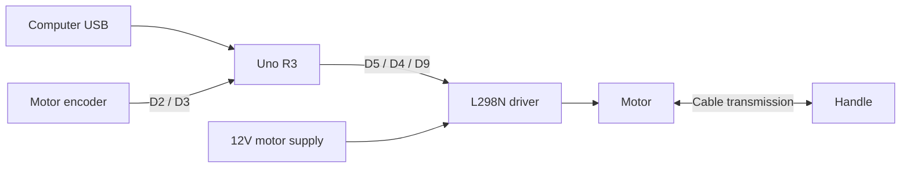

# Wiring and assembly

[Home](../README.md) · [Parts](../PARTS.md) · [First run](CALIBRATION.md)

## Assemble the mechanism

Use the [camp lab guides](https://github.com/rneum/RobotCamp2026) and [STL/STEP files](https://github.com/rneum/RobotCamp2026/tree/main/Hapkit%20Parts/1DOF%20STL) as the mechanical reference. This repository does not invent print tolerances or cable-routing steps absent from the source. Match the actual bearing, fastener, motor, and cable dimensions before assembly.

Before powering the motor, confirm the handle travels smoothly, printed parts and fasteners are secure, and the drive cable transmits handle motion to the motor shaft without slipping. Binding and cable slip can look like a firmware problem.

## Control connections

Disconnect the motor supply while changing wiring.

| From | To | Purpose |
|---|---|---|
| Uno D5 | L298N IN1 | Direction |
| Uno D4 | L298N IN2 | Direction |
| Uno D9 | L298N ENA, for the IN1/IN2 channel | 20 kHz PWM |
| Uno D2 | Encoder A | Encoder signal |
| Uno D3 | Encoder B | Encoder signal |
| Uno GND | Driver GND and encoder GND | Shared signal reference |
| Uno 5V | Encoder Vcc | 5V encoder signal levels |
| Motor leads | Driver outputs for the IN1/IN2 channel | Motor power |

The sketch constructs `Encoder encoder(3, 2)`, matching the camp's channel order. Direction depends on both motor and encoder connections; run the centering test before using strong effects.

## Pololu 4860 wire colors

For the exact [Pololu 4860 motor/encoder](https://www.pololu.com/product/4860), the manufacturer identifies red/black as motor leads, green as encoder ground, blue as encoder Vcc, yellow as encoder A, and white as encoder B. Match the manufacturer's wiring if you use another motor or cable.

Power the encoder from 5V for direct Uno inputs: its outputs rise to its supply voltage. Do not feed a 12V encoder output into Arduino input pins.

## Motor supply and driver jumpers

The camp BOM specifies a 12V, 2A supply. Connect its polarity correctly to the driver's motor supply terminals using the camp/module instructions. USB supplies the Arduino; USB alone does not provide the separate motor power required here.

On common L298N modules, the ENA jumper holds the channel enabled. Remove that channel's ENA jumper before driving ENA from D9. The separate **5V regulator/enable jumper is a different jumper**: its correct configuration depends on the specific module. Follow that module's instructions before connecting logic power. Do not connect two 5V outputs together or treat every module's 5V terminal as an input.

The pin table above assumes the IN1/IN2 motor channel. If using IN3/IN4 instead, its enable pin and wiring must change consistently.

## How the system connects

This shows signal and power flow; use the tables and module documentation for individual terminals and common ground.
